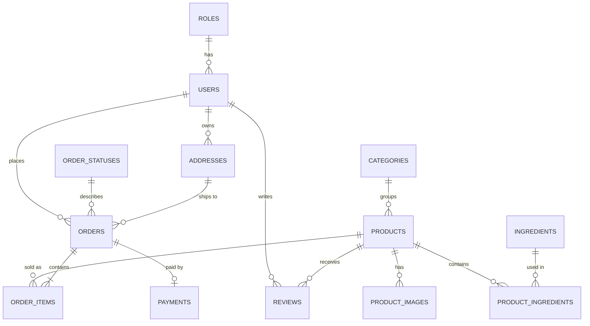

# Mum's Homemade Jams — Project plan

E-commerce site for selling mum's homemade jams. All site content is in English; prices are in lei (RON).
Goal: satisfy **every** criterion in `Barem_evaluare_proiect_web.pdf` (grade 10/10), with visible proof for each.

---

## 1. Stack & key decisions

| Layer | Choice | Why |
|---|---|---|
| Frontend (View) | Svelte 5 + Vite + TypeScript (SPA) | Already scaffolded; TS gives interfaces/classes on the client too |
| Backend (Controller + Model) | Flask 3 REST API (`/api/*`) | Already in `backend/.venv` |
| ORM / DB | SQLAlchemy 2 + Flask-Migrate, SQLite (dev & prod) | Parameterized queries → SQLi protection; 3NF schema with migrations |
| Validation | Pydantic v2 | Typed request schemas, clear 400 errors |
| Auth | Flask-Login (session cookie: HttpOnly, Secure, SameSite=Lax) + Werkzeug scrypt hashing | Works naturally with CSRF tokens; no JWT-in-localStorage XSS risk |
| CSRF | Flask-WTF `CSRFProtect`, token sent in `X-CSRFToken` header | Rubric 9.01 |
| Rate limiting | Flask-Limiter, `100 per minute` global (+ `5/min` on login) | Rubric 10.01 |
| CAPTCHA | Cloudflare Turnstile (free) | Rubric 10.02 |
| Images | Pillow (validate + re-encode) | Rubric 9.04, 9.05, 10.03 |
| Payments | **Stripe Checkout** (hosted page, test mode, currency `ron`) + webhook | Rubric 8.02; hosted page = no card data touches our server |
| Hosting | **Azure for Students** VM (free, no card) + **Apache 2 + mod_wsgi** + Let's Encrypt HTTPS on the free Azure DNS name | Free; `.htaccess` needs Apache (10.05); HTTPS needed for HSTS (10.04); persistent disk for DB, uploads, logs |
| Tests / CI | pytest (backend), Vitest (frontend), GitHub Actions | Rubric 6.01, 6.03 |

**Payment:** card only, through Stripe Checkout in test mode (free, no company needed). No cash-on-delivery branch, to keep the order flow simple.

---

## 2. Architecture

```
Browser (Svelte SPA)  ──HTTPS──►  Apache
                                   ├── /            → static files from frontend dist/ (+ .htaccess)
                                   ├── /uploads/    → product images (+ .htaccess: images only, no exec)
                                   └── /api/*       → mod_wsgi → Flask app
                                                         Controllers (blueprints)
                                                           → Services (business logic)
                                                             → Repositories (data access)
                                                               → Models (SQLAlchemy) → SQLite
```

Patterns used (Rubric 2.03): **MVC** (Model = SQLAlchemy models, View = Svelte, Controller = Flask blueprints), **Repository**, **Service layer**, **Application factory**, **Dependency injection** of the payment gateway (real Stripe vs fake in tests).

### Backend layout
```
backend/
  app/
    __init__.py            # create_app() factory, registers blueprints, error handlers, headers
    config.py              # Dev / Test / Prod config classes (inherit from BaseConfig)
    extensions.py          # db, migrate, login_manager, csrf, limiter
    errors.py              # exception hierarchy + JSON error handlers
    models/                # User, Role, Address, Category, Product, ProductImage, Ingredient,
                           # Order, OrderItem, OrderStatus, Payment, Review, ContactMessage
    repositories/
      base.py              # IRepository (ABC interface) + SqlAlchemyRepository[T] (generic base)
      product_repository.py, order_repository.py, user_repository.py, ...
    services/
      auth_service.py, cart_service.py, order_service.py, review_service.py
      payments/            # PaymentGateway (ABC) → StripeGateway, FakeGateway
      uploads/             # FileValidator (ABC) → ImageValidator; ImageSanitizer
      captcha_service.py   # Turnstile verification
      activity_logger.py   # user-action log
    controllers/           # blueprints: auth, products, categories, cart, orders, payments,
                           # reviews, contact, admin
    schemas/               # Pydantic request/response schemas
    security/              # access.py: user loader, 401 handler, @role_required; later headers, sanitization
  migrations/
  tests/
  uploads/                 # served by Apache, has its own .htaccess
  logs/activity.log        # gitignored, outside web root
  seed.py                  # demo categories, products, admin account
  wsgi.py
  requirements.txt / requirements-dev.txt
```

### Frontend layout
```
src/
  main.ts, App.svelte
  lib/
    api/client.ts          # class ApiClient (fetch wrapper, CSRF header, error mapping)
    api/types.ts           # interfaces: Product, Category, CartItem, Order, User, ApiError
    stores/cart.svelte.ts  # class CartStore (runes, persisted in localStorage)
    stores/auth.svelte.ts  # class AuthStore
    router/                # small history-API router + route guards
    components/            # Header, Footer, Carousel, ProductCard, ProductGrid, CartDrawer,
                           # QuantityPicker, Turnstile, Seo, Toast, Modal, OrderStatusBadge,
                           # ImageUploader, DataTable
  pages/                   # one Svelte file per route (see §5)
  styles/
    variables.css          # colours, fonts, spacing (CSS custom properties)
    base.css               # reset, typography
    layout.css             # grid, header/footer, breakpoints
    components.css         # buttons, cards, forms, tables
    animations.css         # @keyframes, transitions, reduced-motion
public/
  .htaccess, favicon, og-image.jpg, images/   # robots.txt and sitemap.xml are generated by Flask (always current)
```

---

## 3. Database (3NF) — Rubric 2.01



| Table | Columns (PK **bold**, FK *italic*) |
|---|---|
| roles | **id**, name UNIQUE (`client`, `admin`) |
| users | **id**, email UNIQUE, password_hash, first_name, last_name, phone, *role_id*, created_at |
| addresses | **id**, *user_id*, street, city, county, postal_code, is_archived |
| categories | **id**, name UNIQUE, slug UNIQUE, description |
| products | **id**, *category_id*, name, slug UNIQUE, description, price_cents, weight_grams, stock, is_active, created_at |
| product_images | **id**, *product_id*, filename, alt_text, position |
| ingredients | **id**, name UNIQUE |
| product_ingredients | ***product_id*, *ingredient_id*** (composite PK) |
| order_statuses | **id**, code UNIQUE, name UNIQUE (`Awaiting payment`, `Paid`, `Confirmed`, `Shipped`, `Delivered`, `Cancelled`) |
| orders | **id**, *user_id*, *address_id*, *status_id*, created_at, notes |
| order_items | ***order_id*, *product_id***, quantity, unit_price_cents |
| payments | **id**, *order_id* UNIQUE, provider, provider_reference UNIQUE, amount_cents, status, paid_at |
| reviews | **id**, *user_id*, *product_id*, rating (1–5, CHECK), comment, created_at; UNIQUE(user_id, product_id) |
| contact_messages | **id**, name, email, subject, message, created_at |

Full diagram and 3NF justification: [`docs/DATABASE.md`](docs/DATABASE.md). Money is stored as integer cents (1 leu = 100 cents), matching Stripe's minor units.

3NF justification:
- No derived data stored: order total = Σ(quantity × unit_price), computed. Average rating computed.
- `unit_price` in order_items depends on the full key (price at purchase time), not on product alone.
- Lookups (roles, statuses, categories, ingredients) are separate tables → no repeated text values.
- Addresses are archived, never edited once used by an order → order history stays correct without duplicating address text.
- Many-to-many (products ↔ ingredients) resolved through a junction table.

---

## 4. Use cases — Rubric 2.02 (needs ≥4, we have 8)

| # | Actor | Scenario |
|---|---|---|
| UC1 | Visitor | Browse catalogue, filter by category, search, sort by price; open product page (images, ingredient list, product facts table, reviews) |
| UC2 | Visitor / Client | Cart: add, change quantity, remove, see total |
| UC3 | Visitor | Register (CAPTCHA), log in (CAPTCHA after failures / always), log out |
| UC4 | Client | Checkout: choose/add address → pay by card (Stripe) → order confirmation |
| UC5 | Client | "My orders": order history table, order detail, cancel a not-yet-shipped order |
| UC6 | Client | Leave a review (1–5 ★ + comment) on a product they bought |
| UC7 | Visitor | Contact form (CAPTCHA) |
| UC8 | Admin (Mum) | Product CRUD with image upload, stock management, order status updates, view messages, view activity log |

---

## 5. Pages & routes

| Route | Page | Access |
|---|---|---|
| `/` | Home — hero **carousel**, featured jams, "Mum's story" teaser, testimonials | public |
| `/products` | Catalogue with filters | public |
| `/products/:slug` | Product detail (gallery, **product facts table**, ingredients, reviews) | public |
| `/cart` | Shopping cart | public |
| `/checkout` | Checkout | client |
| `/checkout/success`, `/checkout/cancelled` | Stripe return pages | client |
| `/login`, `/register` | Login / Register | guests only |
| `/account` | Profile + addresses | client |
| `/account/orders` | Order history | client |
| `/about` | Mum's story, photos, optional audio clip | public |
| `/contact` | Contact form + map link | public |
| `/terms`, `/privacy`, `/delivery` | Legal / delivery info (links in footer, ANPC/SAL links) | public |
| `/admin` | Dashboard (sales, low-stock table) | admin |
| `/admin/products`, `/admin/products/new`, `/admin/products/:id` | Product CRUD + upload | admin |
| `/admin/orders` | Orders + status changes | admin |
| `/admin/messages` | Contact messages | admin |
| `/admin/activity-log` | Activity log viewer (filter by user/action/date) | admin |
| `*` | 404 "This jar is empty" | public |

---

## 6. API endpoints

| Method | Endpoint | Access | Notes |
|---|---|---|---|
| GET | `/api/csrf` | public | returns CSRF token |
| POST | `/api/auth/register` · `/login` · `/logout` | public / client | CAPTCHA on register + login |
| GET | `/api/auth/me` | client | current user + role |
| GET | `/api/categories` | public | |
| GET | `/api/products?category=&q=&sort=&page=` | public | paginated |
| GET | `/api/products/:slug` | public | with images, ingredients, reviews |
| POST | `/api/cart/validate` | public | re-prices cart server-side, checks stock |
| GET/POST/DELETE | `/api/addresses` | client | |
| POST | `/api/orders` | client | creates order; card → returns Stripe Checkout URL |
| GET | `/api/orders`, `/api/orders/:id` | client (own only) | |
| POST | `/api/orders/:id/cancel` | client (own only) | only before shipping |
| POST | `/api/payments/webhook` | Stripe | signature-verified, CSRF-exempt |
| POST | `/api/products/:id/reviews` | client (must have bought it) | |
| POST | `/api/contact` | public | CAPTCHA |
| POST/PUT/DELETE | `/api/admin/products[/:id]` | admin | |
| POST | `/api/admin/products/:id/images` | admin | multipart upload, all file checks |
| PATCH | `/api/admin/orders/:id/status` | admin | |
| GET | `/api/admin/messages`, `/api/admin/logs` | admin | |

---

## 7. Rubric → implementation map

### Grade 2 — Base functionality & architecture
| Criterion | Implementation | Proof |
|---|---|---|
| 2.01 DB 3NF | Schema in §3, migrations | ER diagram + 3NF section in README |
| 2.02 ≥4 use cases | UC1–UC8 | Demo script |
| 2.03 Architecture | MVC + Repository + Service | Folder tree + diagram in README |
| 2.04 Content/multimedia | Images (products, carousel), text, **tables** (product facts, orders, admin), links (nav, footer, legal); optional audio on the About page | Pages |

### Grade 3 — OOP & access control
| Criterion | Implementation |
|---|---|
| 3.01 ≥3 classes | Models, repositories, services, `ApiClient`, `CartStore` (dozens) |
| 3.02 Interface | Python ABCs: `IRepository`, `PaymentGateway`, `FileValidator`; TS interfaces in `types.ts` |
| 3.03 Authentication | Register/login/logout, Flask-Login sessions, hashed passwords |
| 3.04 Authorization | Roles `client`/`admin`; `@login_required`, `@role_required("admin")`; ownership checks (client sees only own orders); frontend route guards (UX only — backend is the enforcement) |

### Grade 4 — OOP concepts & interactivity
| Criterion | Implementation |
|---|---|
| 4.01 Inheritance | `SqlAlchemyRepository` → `ProductRepository`, `OrderRepository`…; `AppError` → `ValidationError`, `AuthenticationError`, `ForbiddenError`, `NotFoundError`, `ConflictError` (done), `OutOfStockError`, `PaymentError`, `UploadError` (later phases); `BaseConfig` → `DevelopmentConfig`/`TestingConfig`/`ProductionConfig`; `StripeGateway`/`FakeGateway` → `PaymentGateway` |
| 4.02 ≥2 exception types | Custom hierarchy above + `IntegrityError`, `stripe.error.StripeError`, `PIL.UnidentifiedImageError`, `RequestEntityTooLarge`, `pydantic.ValidationError` — all caught and mapped to JSON errors with clear English messages; frontend `ApiError` handling with toasts |
| 4.03 Carousel | `Carousel.svelte` on home: autoplay, prev/next, dots, swipe on mobile, keyboard arrows, pause on hover, `aria-live` |
| 4.04 Animation | CSS `@keyframes` (jar lid "pop" on add-to-cart, fade-in-up of cards on scroll), Svelte `fly`/`fade` transitions (cart drawer, toasts), cart badge bounce; all honour `prefers-reduced-motion` |

### Grade 5 — CSS & responsive
| Criterion | Implementation |
|---|---|
| 5.01 ≥2 CSS files, ≥10 properties | 5 files in `src/styles/` (+ scoped component styles); grid, flex, custom properties, transform, transition, box-shadow, border-radius, clamp() fonts, object-fit, aspect-ratio, etc. |
| 5.02 Responsive | Mobile-first; breakpoints 600px (tablet) / 1024px (desktop); hamburger menu; product grid 1→2→3/4 columns; tables scroll horizontally on mobile; tested in DevTools device mode (screenshots for README) |

### Grade 6 — Testing & automation
| Criterion | Implementation |
|---|---|
| 6.01 ≥5 unit tests | Target ~20 pytest + ~5 Vitest (list in §8) |
| 6.02 Git | Repo `SebiSomu/Site-DAW`; feature branches + PRs, meaningful commits |
| 6.03 CI | `.github/workflows/ci.yml`: on push/PR → backend job (install, `pytest`) + frontend job (`npm ci`, `npm run check`, `vitest run`, `npm run build`, upload `dist` artifact). Badge in README |

### Grade 7 — Monitoring & hosting
| Criterion | Implementation |
|---|---|
| 7.01 Logging | `ActivityLogger` → `logs/activity.log` (RotatingFileHandler, 1 MB × 5). Format: `timestamp | level | ip | user_id | action | details`. Logged: register, login ok/failed, logout, cart validate, order created/cancelled, payment success/failure, review posted, contact message, admin CRUD, order status change, rejected uploads, rate-limit hits, CSRF failures. Viewable in `/admin/activity-log` |
| 7.02 Hosting | Azure VM + Apache + mod_wsgi + HTTPS (see §9) |

### Grade 8 — SEO & payments
| Criterion | Implementation |
|---|---|
| 8.01 Lighthouse SEO ≥90 | `<html lang="en">`, unique `<title>` + meta description per page (`Seo.svelte`), canonical, Open Graph, `robots.txt`, `sitemap.xml`, descriptive link text, `alt` on every image, real `<a href>` links (crawlable), legible font sizes, viewport meta, HTTPS, JSON-LD `Product`/`Organization`. Target 100 |
| 8.02 Online payments | Stripe Checkout Session in RON; webhook `checkout.session.completed` → order `Paid`, payment row, stock decrement; cancel URL returns to cart. Demo with test card `4242 4242 4242 4242` |

### Grade 9 — Security I
| Criterion | Implementation | Proof |
|---|---|---|
| 9.01 CSRF | `CSRFProtect` on all state-changing endpoints; token via `/api/csrf` → `X-CSRFToken`; `SameSite=Lax` cookies; webhook exempt (Stripe signature instead) | Test: POST without token → 400 |
| 9.02 XSS | Svelte auto-escaping, **no `{@html}` on user data**; server-side sanitizing of review/contact text (`nh3`); strict CSP; `X-Content-Type-Options` | Test: review with `<script>` stored as text |
| 9.03 SQL Injection | Only SQLAlchemy ORM / bound parameters, never string-built SQL; Pydantic input validation | Test: search `' OR 1=1 --` returns nothing harmful |
| 9.04 Max 12 MB | Flask `MAX_CONTENT_LENGTH = 12 * 1024 * 1024` → 413 handler; Apache `LimitRequestBody 12582912`; client-side check before upload | Test: 13 MB file → 413 |
| 9.05 Allowed extensions | Whitelist `.jpg .jpeg .png .webp`; extension **and** real format check (Pillow `verify()`, magic bytes); `secure_filename` + UUID names | Test: `.exe`/`.php`/renamed file rejected |

### Grade 10 — Security II
| Criterion | Implementation | Proof |
|---|---|---|
| 10.01 Rate limiting | Flask-Limiter default `100 per minute` per IP → 429 with `Retry-After`; stricter `5/min` on login | Test + script sending 101 requests |
| 10.02 CAPTCHA | Cloudflare Turnstile on register, login, contact; verified server-side in `CaptchaService` | Demo |
| 10.03 Steganography | `ImageSanitizer`: reject trailing data after image end marker (EOF/IEND), reject polyglots, strip EXIF/metadata, **re-encode** (resize + lossy WebP) which destroys LSB-hidden payloads; rejected files logged | Test: PNG with appended ZIP rejected; output has no EXIF |
| 10.04 Security headers grade A | Apache + Flask: `Strict-Transport-Security`, `Content-Security-Policy`, `X-Frame-Options: DENY`, `X-Content-Type-Options: nosniff`, `Referrer-Policy: strict-origin-when-cross-origin`, `Permissions-Policy`, `Cross-Origin-Opener-Policy`; remove `Server`/`X-Powered-By` details | Screenshot from Security Headers Inspector (+ securityheaders.com) |
| 10.05 .htaccess | Root `.htaccess`: SPA fallback, `Options -Indexes`, deny dotfiles (`.env`, `.git`), deny `*.log *.db *.sqlite *.py *.bak *.ini`, headers, `LimitRequestBody`. `uploads/.htaccess`: allow only image types, disable script execution (`php_flag engine off`, `RemoveHandler`, `SetHandler none`), no listing | `curl` showing 403 on `/.env`, `/logs/`, `/uploads/x.php` |

---

## 8. Test plan (Rubric 6.01)

Backend (pytest, `TestingConfig` with in-memory SQLite, `FakeGateway`, CAPTCHA mocked):
1. Password is hashed and verifies correctly
2. Login with wrong password → 401, logged as failed
3. Client accessing `/api/admin/*` → 403; guest → 401
4. Client cannot read another user's order → 403/404
5. Cart total computed correctly from server prices (ignores client prices)
6. Order rejected when quantity > stock (`OutOfStockError`)
7. Cancel allowed only before shipping
8. Review only allowed for purchased products; one per product
9. Webhook with valid fake event → order `Paid`, stock decreased
10. Webhook with bad signature → 400
11. POST without CSRF token → 400
12. Upload > 12 MB → 413
13. Upload with disallowed extension → 400
14. Upload of fake image (text renamed `.jpg`) → 400
15. Upload with appended data → rejected; clean upload stored without EXIF
16. Search with SQL injection string → safe empty result
17. Review with `<script>` is sanitized
18. 101st request in a minute → 429
19. Activity log line written on login

Frontend (Vitest): CartStore add/update/remove/total, persistence, ApiClient error mapping, price formatting (`24.50 lei`).

---

## 9. Hosting & deployment (Rubric 7.02, 10.04, 10.05)

Chosen: **Azure for Students** (free $100 credit/year, activated with the @student.unitbv.ro email, no credit card) — one small Ubuntu VM. No domain purchase: Azure gives a free DNS name (`mums-jams.westeurope.cloudapp.azure.com`) that Let's Encrypt accepts.

1. Create VM: Ubuntu 24.04, size B1s, open ports 22/80/443, set the DNS name label on the public IP
2. Install: `apache2 libapache2-mod-wsgi-py3 python3-venv certbot python3-certbot-apache`; `a2enmod headers rewrite ssl`
3. VirtualHost: `DocumentRoot` = frontend `dist/`, `AllowOverride All` (so `.htaccess` is honoured), `WSGIScriptAlias /api` → `backend/wsgi.py`, `/robots.txt` and `/sitemap.xml` also routed to Flask, `Alias /uploads` → `backend/uploads`
4. `certbot --apache` → HTTPS + HTTP→HTTPS redirect (auto-renew)
5. `.env` on server only (SECRET_KEY, STRIPE_SECRET_KEY, STRIPE_WEBHOOK_SECRET, TURNSTILE_SECRET), outside web root
6. Stripe Dashboard (test mode) → webhook endpoint `https://<dns-name>/api/payments/webhook`
7. `deploy/` folder in repo: Apache vhost config + `deploy.sh` (git pull, build, migrate, reload). Optional GitHub Actions deploy over SSH

Free services used: Azure for Students, Let's Encrypt, Stripe test mode, Cloudflare Turnstile, GitHub Actions.

---

## 10. Design direction

- Warm, homemade, elegant: cream background, deep jam reds/plum, apricot/amber accents, kraft-paper and gingham touches, hand-drawn label feel.
- Look: pantry label plus recipe book. Gingham bands, kraft tags and footer, index cards held on with tape, a recipe card with ruled lines, 1900s fruit watercolours (USDA Pomological Watercolor Collection, public domain) as recipe-book pages.
- Logo: a jar lid seen from above, covered in red gingham and tied with twine, next to the stacked wordmark (`SiteHeader.svelte`); the lid alone is the favicon.
- Product pictures: until real photos are uploaded, every product has its own jar illustration (`JarArt.svelte`). Jar shape and lid cloth show the category (round jar and red gingham for jams, tall and green for preserves, wide and amber for fruit butters, square and plum for seasonal editions); jam colour, handwritten label, the fruit drawn at the foot and a background tint make each product distinct. Looks per product live in `src/lib/jars.ts`.
- Fonts (self-hosted via `@fontsource-variable`): Caveat for handwritten headings and notes, Fraunces for labels and prices, Nunito for body text.
- Motion: cards sway like paper in a draught, tape lifts on hover, carousel pages turn like a recipe book, scroll-linked entrances; all off under `prefers-reduced-motion`. The jar-lid pop on add-to-cart comes with the cart in phase 5.
- Copy tone: grandmotherly warmth ("Made with love, in a copper pot, the old-fashioned way").
- Accessibility: contrast AA, focus styles, keyboard navigation, `alt` text, form labels.

---

## 11. Phases

| Phase | Work | Rubric covered |
|---|---|---|
| 0. Setup ✅ | Repo hygiene, `requirements.txt`, Flask app factory, Vite proxy `/api` → Flask, CI skeleton | 6.02, 6.03 |
| 1. Data ✅ | Models, migrations, seed (categories, ~10 jams, admin), repositories | 2.01, 2.03, 3.01, 3.02, 4.01 |
| 2. Auth ✅ | Register/login/logout, roles, decorators, CSRF, error hierarchy, logging (backend only; login/register pages come with phase 4–5 UI). CAPTCHA and login rate limit stay in phase 8 | 3.03, 3.04, 4.02, 7.01, 9.01 |
| 3. Catalogue ✅ | Product API + pages, filters, search, product detail, SEO component | 2.02, 2.04, 8.01 |
| 4. UI shell ✅ | Styles (5 CSS files), header/footer, responsive nav, carousel, animations | 4.03, 4.04, 5.01, 5.02 |
| 5. Cart & orders ✅ | CartStore, AuthStore, login and register pages, route guards, checkout, addresses, order history, cancel, reviews, plain-text sanitizing, Vitest. Orders wait at `Awaiting payment` until phase 6 | 2.02, 3.03, 3.04 |
| 6. Payments ✅ | Stripe Checkout + webhook, success/cancel pages, stock decrement on payment, stock restore and refund when a paid order is cancelled, re-check stock at payment time. Remove the "not switched on yet" note from `OrderPage.svelte` | 8.02 |
| 7. Admin ✅ | Product CRUD, secure image upload pipeline, orders, messages, log viewer | 9.04, 9.05, 10.03 |
| 8. Hardening | Rate limiting, Turnstile, CSP & headers, XSS sanitizing, `.htaccess` files | 9.02, 9.03, 10.01, 10.02, 10.04, 10.05 |
| 9. Tests | Full test list §8, coverage report | 6.01 |
| 10. Deploy | Azure VM + Apache + HTTPS, Stripe webhook live (test mode) | 7.02 |
| 11. Proof | Lighthouse report, Security Headers screenshot, curl demos, README with rubric checklist | all |

### Phase 6 subplans

Rubric 8.02: a working online payment system. Do them in order; each ends with the checks green and can be its own commit. 6.1 to 6.5 need no Stripe account, because tests use `FakeGateway`. Only 6.6 needs real test keys.

**Decisions**

- **Stock leaves when the payment succeeds, not when the order is placed**, as planned. Nothing is held for unpaid orders, so an abandoned checkout never blocks a jar. The rare cost: two buyers can pay for the last jar at the same time, so the second one is refunded automatically (6.3).
- **An unpaid order stays open.** When a Stripe session expires, the order stays at `Awaiting payment` and the client can pay again or cancel it.
- **Stripe's webhook is the only thing that marks an order paid.** The success page only reads the status, because anyone can open that URL.
- **No schema change.** `payments` already has what is needed, with one row per order. `provider_reference` holds the Checkout Session id and is replaced when the client retries. The payment intent needed for a refund is read from Stripe through that session.
- **Return URLs come from a `SITE_URL` setting**, never from the request's `Host` header.

**6.1 Gateway foundation ✅**

- Add `stripe` to `requirements.txt`; add `STRIPE_SECRET_KEY`, `STRIPE_WEBHOOK_SECRET` and `SITE_URL` to config and `.env.example`. `ProductionConfig` refuses to start without them.
- `PaymentGateway` ABC in `services/payments/`: `create_checkout(order)`, `parse_webhook(payload, signature)`, `expire_checkout(reference)`, `refund(reference)`. It returns our own small value objects, so no Stripe types leak out.
- `StripeGateway` and `FakeGateway` implement it. `TestingConfig` selects the fake, so tests never touch the network.
- `PaymentError` (`AppError`, 502) and a handler that turns `stripe.StripeError` into a clear JSON message without leaking details.
- Tests: the fake's behaviour, gateway selection by config, a Stripe error mapped to a clean response.
- Rubric: 3.02 (second interface), 4.01, 4.02.

**6.2 Starting a payment ✅**

- `PaymentService.start(order_id, user_id)`: own orders only and only `Awaiting payment`; re-check stock and active products; create the session in `ron` with one line per order item, using `unit_price_cents` from the order, never from the request.
- Create or update the `payments` row as `pending`. A retry expires the previous session first, so one order never has two payable sessions.
- `POST /api/orders/<id>/pay` returns `{"checkout_url": ...}`. `POST /api/orders` stays as it is, so placing and paying remain two steps and a failed Stripe call never loses the order.
- Log `payment_started`.
- Tests: amount comes from the order, another client's order is 404, a paid or cancelled order is 409, out of stock is 409, retry replaces the reference, a gateway failure leaves the order intact.

**6.3 Webhook ✅**

- `POST /api/payments/webhook`: the only CSRF-exempt route, verified by Stripe signature (bad signature is 400 and logged).
- `checkout.session.completed` with `payment_status=paid`, after checking the amount matches: mark the payment `succeeded` with `paid_at`, move the order to `Paid`, and take the stock with a conditional update (`stock = stock - n WHERE stock >= n`), all in one transaction.
- If a jar has sold out in the meantime: refund, cancel the order, log it.
- If the order was already cancelled: refund.
- `checkout.session.expired`: mark the payment `failed`; the order stays open. Other event types get a 200 and are ignored.
- Idempotent: Stripe resends events, so a repeat must not take stock twice or refund twice. A failure returns 500 so Stripe retries.
- Log `payment_succeeded`, `payment_failed`, `payment_refunded`, `webhook_rejected`.
- Tests: plan §8 items 9 and 10, plus duplicate event, oversold jar, amount mismatch, unknown session, cancelled order, and that a paid order makes its jars reviewable.

**6.4 Cancelling and refunds ✅**

- `Awaiting payment`: expire the open session first, so it cannot be paid after the order is cancelled.
- `Paid` or `Confirmed`: refund through the gateway, mark the payment `refunded`, restore the stock, then cancel. If the refund fails, the order stays as it was and the client sees the error.
- Tests: stock restored exactly once, refund failure changes nothing, a shipped order still cannot be cancelled.

**6.5 Frontend ✅**

- Checkout's button becomes "Place order and pay": place the order, clear the cart, ask for `checkout_url`, go to Stripe. If Stripe is unavailable, the client lands on the saved order and can try again.
- `/checkout/success`: re-reads the order for a short while, because the webhook can arrive after the browser. It shows "Paid" or "We are still confirming your payment".
- `/checkout/cancelled`: says nothing was charged and links back to the order.
- Order page: "Pay now" for `Awaiting payment`; cancel text mentions the refund on a paid order; remove the "not switched on yet" note.
- Both return pages are `noindex`. No card data ever touches our pages.
- Tests: Vitest for the status-polling logic; browser run of the whole flow against the fake.

**6.6 Real Stripe test mode and proof ✅**

- Needs from the developer: a Stripe account in test mode, the test keys in `backend/.env`, and the Stripe CLI for `stripe listen --forward-to localhost:5000/api/payments/webhook`.
- Walk through: card `4242 4242 4242 4242` (order `Paid`, stock down, review form appears), declined card `4000 0000 0000 0002`, abandoned checkout, cancel with refund, resent event (`stripe events resend`).
- Update `docs/RUBRIC.md` (8.02), `README.md` and the use case UC4; add screenshots of a paid order and of the Stripe dashboard.
- The live webhook endpoint on the Azure VM is set up in phase 10.
- Done on 23 November 2026 in a Stripe sandbox with `stripe listen`: order 1 paid with `4242…` (Paid, stock 4 → 2 and 22 → 21, review posted), order 2 left at the Stripe page (stays `Awaiting payment`), order 3 paid then cancelled (refunded, stock restored), the paid event resent with `stripe events resend` (no second `payment_succeeded`, stock unchanged).
- Found on the way: Stripe no longer accepts `payment_method_types` on a new Checkout Session, so it was removed and card-only is set under Settings → Payment methods; the gateway log now records Stripe's error code and field.

### Phase 7 subplans

Rubric 9.04, 9.05, 10.03 (uploads) and the admin side of 2.04, 3.04 and 7.01. Each step ends with its tests green.

**7.1 Secure image upload pipeline ✅**

- `MAX_UPLOAD_BYTES = 12 MB` per file; `MAX_CONTENT_LENGTH` is that plus 64 KB for the multipart envelope, so a 12 MB photo still fits. Over the limit is `413` with a clear message, logged as `upload_rejected reason=too_large`. Apache `LimitRequestBody` gets the same number in phase 8.
- `FileValidator` ABC with four checks, run in order: `SizeValidator` (empty or over 12 MB), `ExtensionValidator` (only `.jpg .jpeg .png .webp`), `ImageFormatValidator` (Pillow must open, verify and fully decode it; the real format must match the extension; at least 200 px a side, at most 40 megapixels), `TrailingDataValidator` (walks the JPEG segments, PNG chunks or WebP RIFF size to the real end marker; any byte after it is rejected, which stops appended ZIPs and other polyglots).
- `ImageSanitizer` applies the camera rotation, copies only the pixels into a new image (EXIF, ICC, text chunks and comments are dropped), scales to at most 1600 px and re-encodes as lossy WebP, which also destroys LSB-hidden payloads.
- `UploadStorage` writes under a random UUID name (`<32 hex>.webp`), never the client's name; `/uploads/<name>` serves only names of that shape, as `image/webp` with `nosniff`.
- Every rejection is logged with the check that failed and a `secure_filename` version of the name; a stored photo is logged as `image_stored`.
- Tests: `backend/tests/test_uploads.py`.

**7.2 Admin products API ✅**

- `GET/POST /api/admin/products`, `GET/PUT/DELETE /api/admin/products/<id>`; delete is refused for a jar that is in past orders (hide it instead). The web address is made from the name (diacritics folded) when not given; name, description and ingredients are stored as plain text.
- `POST /api/admin/products/<id>/images` (multipart, through the pipeline), `POST /api/admin/images/<id>/main`, `DELETE /api/admin/images/<id>`. The jar and the alt text are checked before the file is stored, and the file is removed again if saving the row fails, so no orphan files; at most 8 photos a jar.
- Logged: `product_created`, `product_updated` (with the changed fields), `product_deleted`, `product_image_added`, `product_image_main`, `product_image_removed`.
- Tests: `backend/tests/test_admin_products.py`.

**7.3 Admin orders and dashboard ✅**

- `GET /api/admin/orders?status=`, `GET /api/admin/orders/<id>`, `PATCH /api/admin/orders/<id>/status`: paid → confirmed → shipped → delivered, one step at a time, through a conditional `UPDATE ... WHERE status_id = <current>` so two admins cannot both move the same order; awaiting payment, paid and confirmed can be cancelled through the same payment path as the client's cancel (session closed, or refund and restock once). Only the webhook can mark an order paid. The detail lists the allowed next statuses, so the UI only offers valid buttons.
- `GET /api/admin/summary`: takings (sum of `quantity × unit_price_cents` over paid, confirmed, shipped and delivered orders), orders by status, low stock, recent orders, message count, all computed.
- Logged: `order_status_changed` (from, to, by=admin), `order_cancelled by=admin`.
- Tests: `backend/tests/test_admin_orders.py`.

**7.4 Contact form, messages and activity log ✅**

- `POST /api/contact` (CAPTCHA and rate limit come in phase 8): name, subject and message stored as plain text, e-mail lowercased; logged as `contact_message` with the id only, so no address ends up in the log. `GET /api/admin/messages` (newest first, paginated), `DELETE /api/admin/messages/<id>` (logged as `message_deleted`).
- `GET /api/admin/logs`: `ActivityLogReader` parses `activity.log` and its rotated files (`.1` to `.5`) with one strict pattern, newest first; filters by user id, action, level and date range, paginated, and returns the actions seen for the filter list. Lines it cannot read (tracebacks, bad dates) are skipped; details keep any `|` they contain. The query is validated (action pattern, known levels, start date before end date).
- Tests: `backend/tests/test_contact_and_logs.py`.

**7.5 Admin frontend and contact page ✅**

- "Admin" link in the header for admins only; `AdminGate` shows a polite refusal to anyone else (the backend still enforces the role) and adds the admin sub-navigation.
- Pages: `/admin` (takings, orders to send, awaiting payment, messages, orders by status, running low, newest orders), `/admin/products` (every jar with its photo, shelf, price, stock and whether it is shown, searchable), `/admin/products/new` and `/admin/products/<id>` (all fields, web address preview, price typed in lei, delete or hide, photos with alt text, main photo and remove), `/admin/orders` (filter by status in the URL), `/admin/orders/<id>` (only the allowed next steps as buttons, a refund warning before cancelling a paid order), `/admin/messages` (reply by e-mail, delete, pages), `/admin/activity-log` (filters by action, user, level and dates kept in the URL, pages).
- The photo form checks the extension and the 12 MB limit before sending; the server checks everything again.
- `/contact` (public, in the footer and the sitemap) sends to `POST /api/contact`.
- `ApiClient` gained `put`, `patch` and `postForm` (multipart, the browser sets the boundary).
- Tests: `src/lib/admin.test.ts` (price in lei, ingredients, web address, photo check, step labels, query links), `navigation.test.ts`, `client.test.ts`, `format.test.ts`.

**7.6 Docs and browser check ✅**

- Browser run against the fake gateway: a client is refused `/admin`; a guest sends a contact message; the admin sees it on the dashboard, adds a jar (web address from a Romanian name), has a `.php` file stopped in the browser and a photo with hidden data stopped by the server, uploads a clean photo that then shows in the shop, rejects a bad price, filters orders, moves an order paid → confirmed → shipped, cancels an unpaid one, reads and deletes the message and filters the log. Desktop and phone widths.
- Found and fixed on the way: the activity log is now written in UTC and the frontend reads times without an offset as UTC, so order and log times agree in the viewer's time zone; form fields no longer stretch to match a taller neighbour.

### Phase 8 subplans

Rubric 9.02, 9.04, 9.05 (Apache side), 10.01, 10.02, 10.04, 10.05. Already done and only re-checked here: 9.01 CSRF, 9.03 SQL injection, the upload pipeline (7.1). Each step ends with its tests green and can be its own commit. 8.1 to 8.3 need no outside account; 8.2 uses Cloudflare's public test keys until real ones are added.

**Decisions**

- **Flask is the source of truth for limits and CAPTCHA**; Apache only adds what Flask cannot see (static files, request size before Python runs).
- **One CSP, written once.** The policy lives in `backend/app/security/headers.py`; the root `.htaccess` carries the same string, and a test fails if the two drift apart.
- **Rate limits are counted in memory** (`memory://`). The VM runs one mod_wsgi process, so counts are exact; more processes would need Redis, which is out of scope.
- **The Stripe webhook is exempt from the rate limit** as it is from CSRF: Stripe retries in bursts, and the signature already authenticates it.
- **CAPTCHA tokens are single use.** The widget is reset after every failed submit, so a wrong password never leaves the form stuck.

**8.1 Rate limiting ✅**

- Add `Flask-Limiter`; `limiter` in `extensions.py`, key = client IP, `100 per minute` as an application-wide limit (`RATELIMIT_APPLICATION`; Flask-Limiter's "default" limit is counted per route, which would allow 100 a minute on every route), plus `5 per minute` on `POST /api/auth/login`, `POST /api/auth/register` and `POST /api/contact`, which also count toward the 100. Webhook exempt from both.
- `429` goes through the central handlers as `{"error": "Too many requests. Try again in N seconds."}` with `Retry-After`; logged as `rate_limited` with the route.
- CSRF failures were already logged as `csrf_rejected` (plan §7, 7.01).
- `TestingConfig` switches limits off; the rate-limit tests switch them on for one app.
- Frontend: `ApiClient` reads `Retry-After` and shows the wait time.
- Tests: 101st request in a minute is 429 with `Retry-After` (§8 item 18), 6th login is 429, webhook is never limited, log line written; Vitest for the 429 message.

**8.2 CAPTCHA (Cloudflare Turnstile)**

- `CaptchaVerifier` ABC with `TurnstileVerifier` (server-side call to `siteverify` with the secret and the client IP, short timeout) and `FakeVerifier` (tests); chosen by config like the payment gateway.
- `TURNSTILE_SECRET_KEY` in config and `.env.example`, `VITE_TURNSTILE_SITE_KEY` for the frontend; production refuses to start without the secret; development defaults to Cloudflare's always-pass test keys.
- Register, login and contact require `captcha_token`; checked before anything else. Missing or invalid is `400` with a clear message, logged as `captcha_failed`; Cloudflare unreachable is `503`, logged, never a silent pass.
- `Turnstile.svelte` loads the script on demand, renders the widget with a label, exposes the token to the form and resets after a failed submit; used on `/login`, `/register` and `/contact`.
- Tests: each of the three routes rejects a missing or bad token and accepts a good one; verifier error maps to 503; the real verifier sends the secret and IP (HTTP call faked).

**8.3 Security headers and CSP**

- `SecurityHeaders` (`after_request`) on every Flask response: `Content-Security-Policy`, `X-Frame-Options: DENY`, `X-Content-Type-Options: nosniff`, `Referrer-Policy: strict-origin-when-cross-origin`, `Permissions-Policy` (camera, microphone, geolocation, payment off), `Cross-Origin-Opener-Policy: same-origin`, `Strict-Transport-Security` (production only, `max-age=31536000; includeSubDomains`); the `Server` header reduced to a plain name.
- Site CSP: `default-src 'self'`; scripts and frames also from `https://challenges.cloudflare.com` (Turnstile); `img-src 'self' data:`; `object-src 'none'`; `base-uri 'self'`; `form-action 'self'`; `frame-ancestors 'none'`; `upgrade-insecure-requests`. `style-src` allows `'unsafe-inline'` only if Svelte's transitions and `style:` attributes need it; check and remove if possible. JSON responses get `default-src 'none'; frame-ancestors 'none'`.
- Vite dev and preview send the same headers, so CSP violations show up locally, not only on the VM.
- XSS re-check: contact message and admin product text with `<script>` come back as text (§8 item 17); no `{@html}` anywhere.
- Tests: every header present on an API response, HSTS only in production, CSP has no `unsafe-eval` and no `*`.

**8.4 `.htaccess` files and Apache config**

- `public/.htaccess` (copied into `dist/`): SPA fallback that leaves real files, `/api`, `/uploads`, `/robots.txt` and `/sitemap.xml` alone; `Options -Indexes`; deny dotfiles except `/.well-known/` (Let's Encrypt); deny `*.log *.db *.sqlite *.py *.bak *.ini *.env`; the 8.3 headers; `LimitRequestBody 12648448` (same 12 MB + 64 KB as Flask).
- `backend/uploads/.htaccess`: only names matching `^[0-9a-f]{32}\.webp$`, `ForceType image/webp`, `nosniff`, `RemoveHandler`/`SetHandler none`, `php_flag engine off`, no listing.
- `deploy/apache/`: vhost draft (`AllowOverride All`, `WSGIScriptAlias /api`, `Alias /uploads`) and `security.conf` (`ServerTokens Prod`, `ServerSignature Off`, `TraceEnable Off`, `Header unset X-Powered-By`). Used for real in phase 10.
- CI job: start Apache in the GitHub Actions runner with the built `dist/` and the two `.htaccess` files, then `deploy/check-apache.sh` curls `/.env`, `/.git/config`, `/logs/`, `/x.db`, `/uploads/x.php`, `/uploads/` (403 or 404), a deep SPA route (200), a 13 MB POST (413), and checks the headers.
- Test: the CSP in `.htaccess` equals the one in `headers.py`.

**8.5 Docs and browser check**

- Browser run: no CSP violation in the console on any page (shop, checkout redirect to Stripe, admin, photo upload); Turnstile works on the three forms at phone and desktop width; the 6th fast login shows the wait message.
- `deploy/security-demo.sh`: the curl proofs for the README (CSRF 400, 429 after 100, 413, bad extension, headers).
- Update `docs/RUBRIC.md` (9.02, 9.04, 9.05, 10.01, 10.02, 10.04, 10.05), `README.md` (new settings, Turnstile keys) and the §12 checklist. Security Headers grade A screenshot waits for the live site in phase 10.

---

## 12. Deliverable checklist (README "Rubric" section)

- [ ] ER diagram + 3NF explanation
- [ ] Architecture diagram (MVC + Repository)
- [ ] List of use cases with screenshots
- [ ] Classes / interfaces / inheritance / exceptions pointers (file links)
- [ ] Screenshots: desktop / tablet / phone
- [ ] CI badge + test count
- [ ] Sample of `activity.log` + admin log viewer screenshot
- [ ] Live URL
- [ ] Lighthouse SEO screenshot (≥90)
- [ ] Stripe test payment walkthrough
- [ ] Security proofs: CSRF, XSS, SQLi, 12 MB, extensions, 429, CAPTCHA, stego test, headers grade A, `.htaccess` 403s
