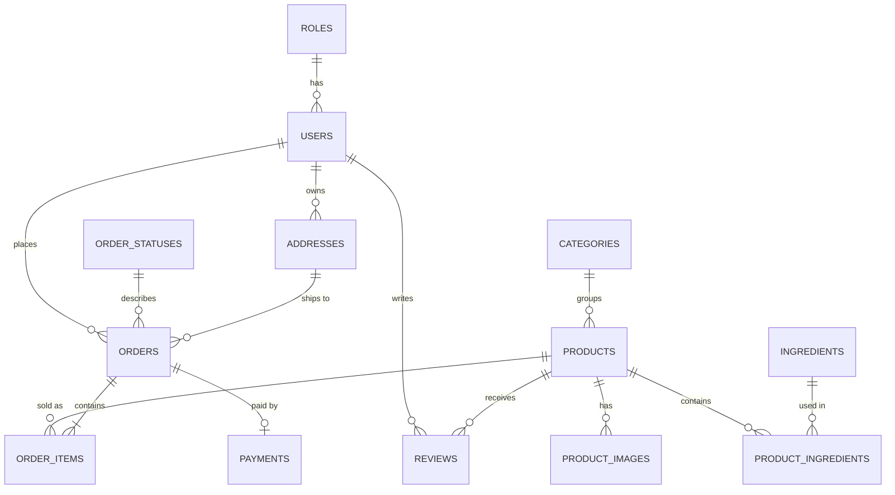

# Mum's Homemade Jams — Project plan

E-commerce site for selling mum's homemade jams. All site content is in English; prices are in lei (RON).
Goal: satisfy **every** criterion in `Barem_evaluare_proiect_web.md` (grade 10/10), with visible proof for each.

---

## 1. Stack & key decisions

| Layer | Choice | Why |
|---|---|---|
| Frontend (View) | Svelte 5 + Vite + TypeScript (SPA) | Already scaffolded; TS gives interfaces/classes on the client too |
| Backend (Controller + Model) | Flask 3 REST API (`/api/*`) | Already in `backend/.venv` |
| ORM / DB | SQLAlchemy 2 + Flask-Migrate, SQLite (dev & prod) | Parameterized queries → SQLi protection; 3NF schema with migrations |
| Validation | Pydantic v2 | Typed request schemas, clear 400 errors |
| Auth | Flask-Login (session cookie: HttpOnly, Secure, SameSite=Lax) + Werkzeug scrypt hashing | Works naturally with CSRF tokens; no JWT-in-localStorage XSS risk |
| CSRF | Flask-WTF `CSRFProtect`, token sent in `X-CSRFToken` header | Barem 9.01 |
| Rate limiting | Flask-Limiter, `100 per minute` global (+ `5/min` on login) | Barem 10.01 |
| CAPTCHA | Cloudflare Turnstile (free) | Barem 10.02 |
| Images | Pillow (validate + re-encode) | Barem 9.04, 9.05, 10.03 |
| Payments | **Stripe Checkout** (hosted page, test mode, currency `ron`) + webhook | Barem 8.02; hosted page = no card data touches our server |
| Hosting | **Azure for Students** VM (free, no card) + **Apache 2 + mod_wsgi** + Let's Encrypt HTTPS on the free Azure DNS name | Free; `.htaccess` needs Apache (10.05); HTTPS needed for HSTS (10.04); persistent disk for DB, uploads, logs |
| Tests / CI | pytest (backend), Vitest (frontend), GitHub Actions | Barem 6.01, 6.03 |

**Payment:** card only, through Stripe Checkout in test mode (free, no company needed). No cash-on-delivery branch, to keep the order flow simple.

---

## 2. Architecture

```
Browser (Svelte SPA)  ──HTTPS──►  Apache
                                   ├── /            → static files from frontend dist/ (+ .htaccess)
                                   ├── /uploads/    → product images (+ .htaccess: images only, no exec)
                                   └── /api/*       → mod_wsgi → Flask app
                                                         Controllers (blueprints)
                                                           → Services (business logic)
                                                             → Repositories (data access)
                                                               → Models (SQLAlchemy) → SQLite
```

Patterns used (Barem 2.03): **MVC** (Model = SQLAlchemy models, View = Svelte, Controller = Flask blueprints), **Repository**, **Service layer**, **Application factory**, **Dependency injection** of the payment gateway (real Stripe vs fake in tests).

### Backend layout
```
backend/
  app/
    __init__.py            # create_app() factory, registers blueprints, error handlers, headers
    config.py              # Dev / Test / Prod config classes (inherit from BaseConfig)
    extensions.py          # db, migrate, login_manager, csrf, limiter
    errors.py              # exception hierarchy + JSON error handlers
    models/                # User, Role, Address, Category, Product, ProductImage, Ingredient,
                           # Order, OrderItem, OrderStatus, Payment, Review, ContactMessage
    repositories/
      base.py              # IRepository (ABC interface) + SqlAlchemyRepository[T] (generic base)
      product_repository.py, order_repository.py, user_repository.py, ...
    services/
      auth_service.py, cart_service.py, order_service.py, review_service.py
      payments/            # PaymentGateway (ABC) → StripeGateway, FakeGateway
      uploads/             # FileValidator (ABC) → ImageValidator; ImageSanitizer
      captcha_service.py   # Turnstile verification
      activity_logger.py   # user-action log
    controllers/           # blueprints: auth, products, categories, cart, orders, payments,
                           # reviews, contact, admin
    schemas/               # Pydantic request/response schemas
    security/              # access.py: user loader, 401 handler, @role_required; later headers, sanitization
  migrations/
  tests/
  uploads/                 # served by Apache, has its own .htaccess
  logs/activity.log        # gitignored, outside web root
  seed.py                  # demo categories, products, admin account
  wsgi.py
  requirements.txt / requirements-dev.txt
```

### Frontend layout
```
src/
  main.ts, App.svelte
  lib/
    api/client.ts          # class ApiClient (fetch wrapper, CSRF header, error mapping)
    api/types.ts           # interfaces: Product, Category, CartItem, Order, User, ApiError
    stores/cart.svelte.ts  # class CartStore (runes, persisted in localStorage)
    stores/auth.svelte.ts  # class AuthStore
    router/                # small history-API router + route guards
    components/            # Header, Footer, Carousel, ProductCard, ProductGrid, CartDrawer,
                           # QuantityPicker, Turnstile, Seo, Toast, Modal, OrderStatusBadge,
                           # ImageUploader, DataTable
  pages/                   # one Svelte file per route (see §5)
  styles/
    variables.css          # colours, fonts, spacing (CSS custom properties)
    base.css               # reset, typography
    layout.css             # grid, header/footer, breakpoints
    components.css         # buttons, cards, forms, tables
    animations.css         # @keyframes, transitions, reduced-motion
public/
  .htaccess, favicon, og-image.jpg, images/   # robots.txt and sitemap.xml are generated by Flask (always current)
```

---

## 3. Database (3NF) — Barem 2.01



| Table | Columns (PK **bold**, FK *italic*) |
|---|---|
| roles | **id**, name UNIQUE (`client`, `admin`) |
| users | **id**, email UNIQUE, password_hash, first_name, last_name, phone, *role_id*, created_at |
| addresses | **id**, *user_id*, street, city, county, postal_code, is_archived |
| categories | **id**, name UNIQUE, slug UNIQUE, description |
| products | **id**, *category_id*, name, slug UNIQUE, description, price_bani, weight_grams, stock, is_active, created_at |
| product_images | **id**, *product_id*, filename, alt_text, position |
| ingredients | **id**, name UNIQUE |
| product_ingredients | ***product_id*, *ingredient_id*** (composite PK) |
| order_statuses | **id**, code UNIQUE, name UNIQUE (`Awaiting payment`, `Paid`, `Confirmed`, `Shipped`, `Delivered`, `Cancelled`) |
| orders | **id**, *user_id*, *address_id*, *status_id*, created_at, notes |
| order_items | ***order_id*, *product_id***, quantity, unit_price_bani |
| payments | **id**, *order_id* UNIQUE, provider, provider_reference UNIQUE, amount_bani, status, paid_at |
| reviews | **id**, *user_id*, *product_id*, rating (1–5, CHECK), comment, created_at; UNIQUE(user_id, product_id) |
| contact_messages | **id**, name, email, subject, message, created_at |

Full diagram and 3NF justification: [`docs/DATABASE.md`](docs/DATABASE.md). Money is stored as integer bani (1 leu = 100 bani), matching Stripe's minor units.

3NF justification:
- No derived data stored: order total = Σ(quantity × unit_price), computed. Average rating computed.
- `unit_price` in order_items depends on the full key (price at purchase time), not on product alone.
- Lookups (roles, statuses, categories, ingredients) are separate tables → no repeated text values.
- Addresses are archived, never edited once used by an order → order history stays correct without duplicating address text.
- Many-to-many (products ↔ ingredients) resolved through a junction table.

---

## 4. Use cases — Barem 2.02 (needs ≥4, we have 8)

| # | Actor | Scenario |
|---|---|---|
| UC1 | Visitor | Browse catalogue, filter by category, search, sort by price; open product page (images, ingredient list, product facts table, reviews) |
| UC2 | Visitor / Client | Cart: add, change quantity, remove, see total |
| UC3 | Visitor | Register (CAPTCHA), log in (CAPTCHA after failures / always), log out |
| UC4 | Client | Checkout: choose/add address → pay by card (Stripe) → order confirmation |
| UC5 | Client | "My orders": order history table, order detail, cancel a not-yet-shipped order |
| UC6 | Client | Leave a review (1–5 ★ + comment) on a product they bought |
| UC7 | Visitor | Contact form (CAPTCHA) |
| UC8 | Admin (mama) | Product CRUD with image upload, stock management, order status updates, view messages, view activity log |

---

## 5. Pages & routes

| Route | Page | Access |
|---|---|---|
| `/` | Home — hero **carousel**, featured jams, "Mum's story" teaser, testimonials | public |
| `/products` | Catalogue with filters | public |
| `/products/:slug` | Product detail (gallery, **product facts table**, ingredients, reviews) | public |
| `/cart` | Shopping cart | public |
| `/checkout` | Checkout | client |
| `/checkout/success`, `/checkout/cancelled` | Stripe return pages | client |
| `/login`, `/register` | Login / Register | guests only |
| `/account` | Profile + addresses | client |
| `/account/orders` | Order history | client |
| `/about` | Mum's story, photos, optional audio clip | public |
| `/contact` | Contact form + map link | public |
| `/terms`, `/privacy`, `/delivery` | Legal / delivery info (links in footer, ANPC/SAL links) | public |
| `/admin` | Dashboard (sales, low-stock table) | admin |
| `/admin/products`, `/admin/products/new`, `/admin/products/:id` | Product CRUD + upload | admin |
| `/admin/orders` | Orders + status changes | admin |
| `/admin/messages` | Contact messages | admin |
| `/admin/activity-log` | Activity log viewer (filter by user/action/date) | admin |
| `*` | 404 "This jar is empty" | public |

---

## 6. API endpoints

| Method | Endpoint | Access | Notes |
|---|---|---|---|
| GET | `/api/csrf` | public | returns CSRF token |
| POST | `/api/auth/register` · `/login` · `/logout` | public / client | CAPTCHA on register + login |
| GET | `/api/auth/me` | client | current user + role |
| GET | `/api/categories` | public | |
| GET | `/api/products?category=&q=&sort=&page=` | public | paginated |
| GET | `/api/products/:slug` | public | with images, ingredients, reviews |
| POST | `/api/cart/validate` | public | re-prices cart server-side, checks stock |
| GET/POST/DELETE | `/api/addresses` | client | |
| POST | `/api/orders` | client | creates order; card → returns Stripe Checkout URL |
| GET | `/api/orders`, `/api/orders/:id` | client (own only) | |
| POST | `/api/orders/:id/cancel` | client (own only) | only before shipping |
| POST | `/api/payments/webhook` | Stripe | signature-verified, CSRF-exempt |
| POST | `/api/products/:id/reviews` | client (must have bought it) | |
| POST | `/api/contact` | public | CAPTCHA |
| POST/PUT/DELETE | `/api/admin/products[/:id]` | admin | |
| POST | `/api/admin/products/:id/images` | admin | multipart upload, all file checks |
| PATCH | `/api/admin/orders/:id/status` | admin | |
| GET | `/api/admin/messages`, `/api/admin/logs` | admin | |

---

## 7. Barem → implementation map

### Nota 2 — Base functionality & architecture
| Criterion | Implementation | Proof |
|---|---|---|
| 2.01 DB 3NF | Schema in §3, migrations | ER diagram + 3NF section in README |
| 2.02 ≥4 use cases | UC1–UC8 | Demo script |
| 2.03 Architecture | MVC + Repository + Service | Folder tree + diagram in README |
| 2.04 Content/multimedia | Images (products, carousel), text, **tables** (product facts, orders, admin), links (nav, footer, legal); optional audio on the About page | Pages |

### Nota 3 — OOP & access control
| Criterion | Implementation |
|---|---|
| 3.01 ≥3 classes | Models, repositories, services, `ApiClient`, `CartStore` (dozens) |
| 3.02 Interface | Python ABCs: `IRepository`, `PaymentGateway`, `FileValidator`; TS interfaces in `types.ts` |
| 3.03 Authentication | Register/login/logout, Flask-Login sessions, hashed passwords |
| 3.04 Authorization | Roles `client`/`admin`; `@login_required`, `@role_required("admin")`; ownership checks (client sees only own orders); frontend route guards (UX only — backend is the enforcement) |

### Nota 4 — OOP concepts & interactivity
| Criterion | Implementation |
|---|---|
| 4.01 Inheritance | `SqlAlchemyRepository` → `ProductRepository`, `OrderRepository`…; `AppError` → `ValidationError`, `AuthenticationError`, `ForbiddenError`, `NotFoundError`, `ConflictError` (done), `OutOfStockError`, `PaymentError`, `UploadError` (later phases); `BaseConfig` → `DevelopmentConfig`/`TestingConfig`/`ProductionConfig`; `StripeGateway`/`FakeGateway` → `PaymentGateway` |
| 4.02 ≥2 exception types | Custom hierarchy above + `IntegrityError`, `stripe.error.StripeError`, `PIL.UnidentifiedImageError`, `RequestEntityTooLarge`, `pydantic.ValidationError` — all caught and mapped to JSON errors with clear English messages; frontend `ApiError` handling with toasts |
| 4.03 Carousel | `Carousel.svelte` on home: autoplay, prev/next, dots, swipe on mobile, keyboard arrows, pause on hover, `aria-live` |
| 4.04 Animation | CSS `@keyframes` (jar lid "pop" on add-to-cart, fade-in-up of cards on scroll), Svelte `fly`/`fade` transitions (cart drawer, toasts), cart badge bounce; all honour `prefers-reduced-motion` |

### Nota 5 — CSS & responsive
| Criterion | Implementation |
|---|---|
| 5.01 ≥2 CSS files, ≥10 properties | 5 files in `src/styles/` (+ scoped component styles); grid, flex, custom properties, transform, transition, box-shadow, border-radius, clamp() fonts, object-fit, aspect-ratio, etc. |
| 5.02 Responsive | Mobile-first; breakpoints 600px (tablet) / 1024px (desktop); hamburger menu; product grid 1→2→3/4 columns; tables scroll horizontally on mobile; tested in DevTools device mode (screenshots for README) |

### Nota 6 — Testing & automation
| Criterion | Implementation |
|---|---|
| 6.01 ≥5 unit tests | Target ~20 pytest + ~5 Vitest (list in §8) |
| 6.02 Git | Repo `SebiSomu/Site-DAW`; feature branches + PRs, meaningful commits |
| 6.03 CI | `.github/workflows/ci.yml`: on push/PR → backend job (install, `pytest`) + frontend job (`npm ci`, `npm run check`, `vitest run`, `npm run build`, upload `dist` artifact). Badge in README |

### Nota 7 — Monitoring & hosting
| Criterion | Implementation |
|---|---|
| 7.01 Logging | `ActivityLogger` → `logs/activity.log` (RotatingFileHandler, 1 MB × 5). Format: `timestamp | level | ip | user_id | action | details`. Logged: register, login ok/failed, logout, cart validate, order created/cancelled, payment success/failure, review posted, contact message, admin CRUD, order status change, rejected uploads, rate-limit hits, CSRF failures. Viewable in `/admin/activity-log` |
| 7.02 Hosting | Azure VM + Apache + mod_wsgi + HTTPS (see §9) |

### Nota 8 — SEO & payments
| Criterion | Implementation |
|---|---|
| 8.01 Lighthouse SEO ≥90 | `<html lang="en">`, unique `<title>` + meta description per page (`Seo.svelte`), canonical, Open Graph, `robots.txt`, `sitemap.xml`, descriptive link text, `alt` on every image, real `<a href>` links (crawlable), legible font sizes, viewport meta, HTTPS, JSON-LD `Product`/`Organization`. Target 100 |
| 8.02 Online payments | Stripe Checkout Session in RON; webhook `checkout.session.completed` → order `Paid`, payment row, stock decrement; cancel URL returns to cart. Demo with test card `4242 4242 4242 4242` |

### Nota 9 — Security I
| Criterion | Implementation | Proof |
|---|---|---|
| 9.01 CSRF | `CSRFProtect` on all state-changing endpoints; token via `/api/csrf` → `X-CSRFToken`; `SameSite=Lax` cookies; webhook exempt (Stripe signature instead) | Test: POST without token → 400 |
| 9.02 XSS | Svelte auto-escaping, **no `{@html}` on user data**; server-side sanitizing of review/contact text (`nh3`); strict CSP; `X-Content-Type-Options` | Test: review with `<script>` stored as text |
| 9.03 SQL Injection | Only SQLAlchemy ORM / bound parameters, never string-built SQL; Pydantic input validation | Test: search `' OR 1=1 --` returns nothing harmful |
| 9.04 Max 12 MB | Flask `MAX_CONTENT_LENGTH = 12 * 1024 * 1024` → 413 handler; Apache `LimitRequestBody 12582912`; client-side check before upload | Test: 13 MB file → 413 |
| 9.05 Allowed extensions | Whitelist `.jpg .jpeg .png .webp`; extension **and** real format check (Pillow `verify()`, magic bytes); `secure_filename` + UUID names | Test: `.exe`/`.php`/renamed file rejected |

### Nota 10 — Security II
| Criterion | Implementation | Proof |
|---|---|---|
| 10.01 Rate limiting | Flask-Limiter default `100 per minute` per IP → 429 with `Retry-After`; stricter `5/min` on login | Test + script sending 101 requests |
| 10.02 CAPTCHA | Cloudflare Turnstile on register, login, contact; verified server-side in `CaptchaService` | Demo |
| 10.03 Steganography | `ImageSanitizer`: reject trailing data after image end marker (EOF/IEND), reject polyglots, strip EXIF/metadata, **re-encode** (resize + lossy WebP) which destroys LSB-hidden payloads; rejected files logged | Test: PNG with appended ZIP rejected; output has no EXIF |
| 10.04 Security headers grade A | Apache + Flask: `Strict-Transport-Security`, `Content-Security-Policy`, `X-Frame-Options: DENY`, `X-Content-Type-Options: nosniff`, `Referrer-Policy: strict-origin-when-cross-origin`, `Permissions-Policy`, `Cross-Origin-Opener-Policy`; remove `Server`/`X-Powered-By` details | Screenshot from Security Headers Inspector (+ securityheaders.com) |
| 10.05 .htaccess | Root `.htaccess`: SPA fallback, `Options -Indexes`, deny dotfiles (`.env`, `.git`), deny `*.log *.db *.sqlite *.py *.bak *.ini`, headers, `LimitRequestBody`. `uploads/.htaccess`: allow only image types, disable script execution (`php_flag engine off`, `RemoveHandler`, `SetHandler none`), no listing | `curl` showing 403 on `/.env`, `/logs/`, `/uploads/x.php` |

---

## 8. Test plan (Barem 6.01)

Backend (pytest, `TestingConfig` with in-memory SQLite, `FakeGateway`, CAPTCHA mocked):
1. Password is hashed and verifies correctly
2. Login with wrong password → 401, logged as failed
3. Client accessing `/api/admin/*` → 403; guest → 401
4. Client cannot read another user's order → 403/404
5. Cart total computed correctly from server prices (ignores client prices)
6. Order rejected when quantity > stock (`OutOfStockError`)
7. Cancel allowed only before shipping
8. Review only allowed for purchased products; one per product
9. Webhook with valid fake event → order `Paid`, stock decreased
10. Webhook with bad signature → 400
11. POST without CSRF token → 400
12. Upload > 12 MB → 413
13. Upload with disallowed extension → 400
14. Upload of fake image (text renamed `.jpg`) → 400
15. Upload with appended data → rejected; clean upload stored without EXIF
16. Search with SQL injection string → safe empty result
17. Review with `<script>` is sanitized
18. 101st request in a minute → 429
19. Activity log line written on login

Frontend (Vitest): CartStore add/update/remove/total, persistence, ApiClient error mapping, price formatting (`24.50 lei`).

---

## 9. Hosting & deployment (Barem 7.02, 10.04, 10.05)

Chosen: **Azure for Students** (free $100 credit/year, activated with the @student.unitbv.ro email, no credit card) — one small Ubuntu VM. No domain purchase: Azure gives a free DNS name (`gemuri-mama.westeurope.cloudapp.azure.com`) that Let's Encrypt accepts.

1. Create VM: Ubuntu 24.04, size B1s, open ports 22/80/443, set the DNS name label on the public IP
2. Install: `apache2 libapache2-mod-wsgi-py3 python3-venv certbot python3-certbot-apache`; `a2enmod headers rewrite ssl`
3. VirtualHost: `DocumentRoot` = frontend `dist/`, `AllowOverride All` (so `.htaccess` is honoured), `WSGIScriptAlias /api` → `backend/wsgi.py`, `/robots.txt` and `/sitemap.xml` also routed to Flask, `Alias /uploads` → `backend/uploads`
4. `certbot --apache` → HTTPS + HTTP→HTTPS redirect (auto-renew)
5. `.env` on server only (SECRET_KEY, STRIPE_SECRET_KEY, STRIPE_WEBHOOK_SECRET, TURNSTILE_SECRET), outside web root
6. Stripe Dashboard (test mode) → webhook endpoint `https://<dns-name>/api/payments/webhook`
7. `deploy/` folder in repo: Apache vhost config + `deploy.sh` (git pull, build, migrate, reload). Optional GitHub Actions deploy over SSH

Free services used: Azure for Students, Let's Encrypt, Stripe test mode, Cloudflare Turnstile, GitHub Actions.

---

## 10. Design direction

- Warm, homemade, elegant: cream background, deep jam reds/plum, apricot/amber accents, kraft-paper and gingham touches, hand-drawn label feel.
- Fonts: a serif display font for headings (e.g. Playfair Display / Fraunces), clean sans for body (e.g. Nunito / Source Sans 3) — self-hosted for CSP and performance.
- Copy tone: grandmotherly warmth ("Made with love, in a copper pot, the old-fashioned way").
- Accessibility: contrast AA, focus styles, keyboard navigation, `alt` text, form labels.

---

## 11. Phases

| Phase | Work | Barem covered |
|---|---|---|
| 0. Setup ✅ | Repo hygiene, `requirements.txt`, Flask app factory, Vite proxy `/api` → Flask, CI skeleton | 6.02, 6.03 |
| 1. Data ✅ | Models, migrations, seed (categories, ~10 jams, admin), repositories | 2.01, 2.03, 3.01, 3.02, 4.01 |
| 2. Auth ✅ | Register/login/logout, roles, decorators, CSRF, error hierarchy, logging (backend only; login/register pages come with phase 4–5 UI). CAPTCHA and login rate limit stay in phase 8 | 3.03, 3.04, 4.02, 7.01, 9.01 |
| 3. Catalogue ✅ | Product API + pages, filters, search, product detail, SEO component | 2.02, 2.04, 8.01 |
| 4. UI shell | Styles (5 CSS files), header/footer, responsive nav, carousel, animations | 4.03, 4.04, 5.01, 5.02 |
| 5. Cart & orders | CartStore, checkout, addresses, order history, cancel, reviews | 2.02 |
| 6. Payments | Stripe Checkout + webhook, success/cancel pages | 8.02 |
| 7. Admin | Product CRUD, secure image upload pipeline, orders, messages, log viewer | 9.04, 9.05, 10.03 |
| 8. Hardening | Rate limiting, Turnstile, CSP & headers, XSS sanitizing, `.htaccess` files | 9.02, 9.03, 10.01, 10.02, 10.04, 10.05 |
| 9. Tests | Full test list §8, coverage report | 6.01 |
| 10. Deploy | Azure VM + Apache + HTTPS, Stripe webhook live (test mode) | 7.02 |
| 11. Proof | Lighthouse report, Security Headers screenshot, curl demos, README with barem checklist | all |

---

## 12. Deliverable checklist (README "Barem" section)

- [ ] ER diagram + 3NF explanation
- [ ] Architecture diagram (MVC + Repository)
- [ ] List of use cases with screenshots
- [ ] Classes / interfaces / inheritance / exceptions pointers (file links)
- [ ] Screenshots: desktop / tablet / phone
- [ ] CI badge + test count
- [ ] Sample of `activity.log` + admin log viewer screenshot
- [ ] Live URL
- [ ] Lighthouse SEO screenshot (≥90)
- [ ] Stripe test payment walkthrough
- [ ] Security proofs: CSRF, XSS, SQLi, 12 MB, extensions, 429, CAPTCHA, stego test, headers grade A, `.htaccess` 403s
