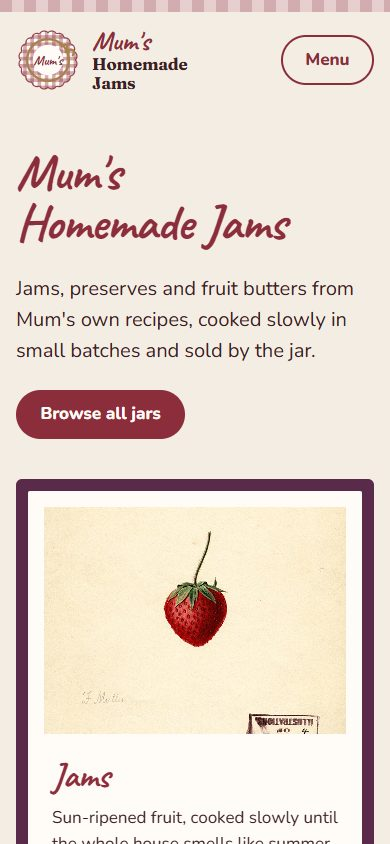
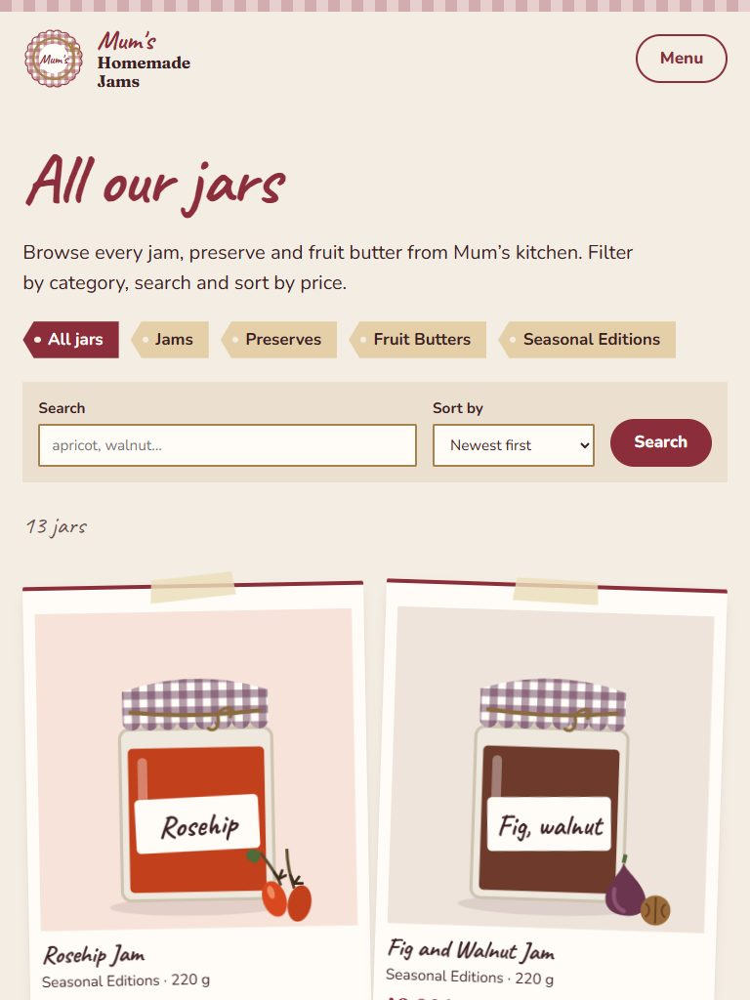
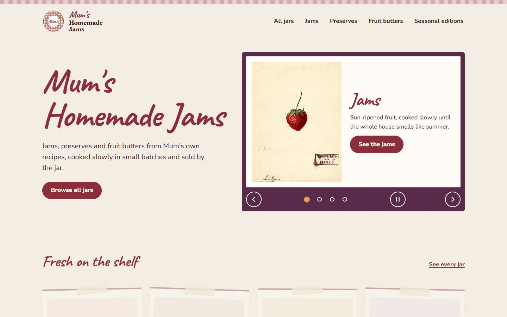

# Mum's Homemade Jams

Online shop for mum's homemade jams. Frontend in **Svelte 5 + Vite + TypeScript**, backend in **Flask (Python)**. All site content is in English; prices are in lei (RON).

- Project plan: [`PLAN.md`](PLAN.md)
- Grading rubric: `Barem_evaluare_proiect_web.pdf` (kept locally, not in git)
- Rubric progress tracker: [`docs/RUBRIC.md`](docs/RUBRIC.md)
- Skill for AI agents: [`.agents/skills/mums-jams-webdev/SKILL.md`](.agents/skills/mums-jams-webdev/SKILL.md)

## Requirements

| Tool | Version | Check |
|---|---|---|
| Git | any recent version | `git --version` |
| Node.js | 20 or newer (includes npm) | `node -v` |
| Python | 3.12 | `python --version` |

## First-time setup

```powershell
git clone https://github.com/SebiSomu/Site-DAW.git
cd Site-DAW
```

### Frontend

```powershell
npm install
```

### Backend

Windows (PowerShell):

```powershell
cd backend
python -m venv .venv
.\.venv\Scripts\Activate.ps1
pip install -r requirements-dev.txt
copy .env.example .env
flask db upgrade
flask seed --demo
cd ..
```

macOS / Linux:

```bash
cd backend
python3 -m venv .venv
source .venv/bin/activate
pip install -r requirements-dev.txt
cp .env.example .env
flask db upgrade
flask seed --demo
cd ..
```

If PowerShell refuses to activate the environment (`running scripts is disabled`), run this once:

```powershell
Set-ExecutionPolicy -Scope CurrentUser RemoteSigned
```

## Running locally

Use two terminals.

Terminal 1, backend (from `backend/`, virtual environment active):

```powershell
flask run
```

Terminal 2, frontend (from the project root):

```powershell
npm run dev
```

Open http://localhost:5173. Vite forwards every `/api/*` and `/uploads/*` request, plus `/robots.txt` and `/sitemap.xml`, to Flask on http://127.0.0.1:5000, so the frontend never needs the backend URL. The shop is at http://localhost:5173/products; it lists the seeded jars when both servers are running.

## Frontend commands

Run these from the project root.

| Command | What it does |
|---|---|
| `npm run dev` | Starts the dev server at http://localhost:5173 (reloads on every save) |
| `npm run check` | Type-checks TypeScript and Svelte components |
| `npm test` | Runs the frontend tests (Vitest) |
| `npm run build` | Builds the production version into `dist/` |
| `npm run preview` | Serves the `dist/` build locally |

## Backend commands

Run these from the `backend/` folder with the virtual environment active (`.\.venv\Scripts\Activate.ps1` on Windows, `source .venv/bin/activate` on macOS/Linux). The terminal prompt then starts with `(.venv)`.

Before the first run, edit `backend/.env`: set a long random `SECRET_KEY` and an `ADMIN_PASSWORD` (the admin account is only created when it is set). `STRIPE_SECRET_KEY` and `STRIPE_WEBHOOK_SECRET` can stay empty until you test real payments; `SITE_URL` is where Stripe sends the customer back. Production refuses to start without all three.

| Command | What it does |
|---|---|
| `pip install -r requirements-dev.txt` | Installs app + test dependencies (run again after new packages are added) |
| `flask db upgrade` | Creates/updates the database in `backend/instance/jams.db` |
| `flask seed` | Adds roles, order statuses, categories, 13 jams and the admin account (safe to run repeatedly) |
| `flask seed --demo` | Same, plus a demo client `client@example.com` / `Client-Demo-123` with no address and no orders |
| `flask db migrate -m "describe change"` | Generates a migration after changing a model; review it, then run `flask db upgrade` |
| `flask db downgrade` | Reverts the last migration |
| `flask run` | Starts the API at http://127.0.0.1:5000 (health check: `/api/health`) |
| `pytest` | Runs the backend tests |
| `deactivate` | Leaves the virtual environment |

To start over with an empty database, delete `backend/instance/jams.db`, then run `flask db upgrade` and `flask seed --demo`.

The database schema, ER diagram and 3NF explanation are in [`docs/DATABASE.md`](docs/DATABASE.md).

## Authentication API

Sessions use a Flask-Login cookie (HttpOnly, SameSite=Lax, Secure in production). Every `POST`/`PUT`/`PATCH`/`DELETE` needs the CSRF token: get it once from `GET /api/csrf` and send it in the `X-CSRFToken` header.

| Method | Endpoint | Access | Result |
|---|---|---|---|
| GET | `/api/csrf` | public | `{"csrf_token": "..."}` |
| POST | `/api/auth/register` | public | `201 {"user": {...}}`, logged in as `client` |
| POST | `/api/auth/login` | public | `200 {"user": {...}}` or `401` |
| POST | `/api/auth/logout` | logged in | `204` |
| GET | `/api/auth/me` | logged in | `200 {"user": {...}}` or `401` |
| GET | `/api/auth/session` | public | `200 {"user": {...}}`, or `{"user": null}` for a guest |

Register body: `email`, `password` (8–128 characters), `first_name`, `last_name`, optional `phone`. Unknown fields are rejected.

Every error is JSON `{"error": "<message>"}` with the matching status: `400` invalid data or missing CSRF token, `401` not logged in, `403` wrong role, `404`, `409` duplicate data, `500`. Admin-only endpoints use the `@role_required(RoleName.ADMIN)` decorator from `app/security/`.

### Activity log

User actions are written to `backend/logs/activity.log` (gitignored, rotated at 1 MB, 5 backups; change the path with `ACTIVITY_LOG_PATH` in `.env`). One line per action:

```
2026-10-28 17:40:02,114 | INFO | 127.0.0.1 | 2 | login | email=client@example.com
```

Logged so far: `register`, `login`, `login_failed`, `logout`, `access_denied`, `csrf_rejected`, `cart_validated`, `address_added`, `address_archived`, `order_created`, `order_cancelled`, `review_posted`.

## Catalogue API

All public, read-only (`GET`, no CSRF token needed). Prices are integer cents (`2450` = `24.50 lei`).

| Endpoint | Result |
|---|---|
| `/api/categories` | `{"categories": [{id, name, slug, description}]}` |
| `/api/products?q=&category=&sort=&page=&per_page=` | `{"items": [...], "total", "page", "per_page", "pages"}` |
| `/api/products/<slug>` | `{"product": {..., description, images, ingredients, average_rating, reviews}}` or `404` |
| `/robots.txt`, `/sitemap.xml` | Generated from the database, so new products appear in the sitemap automatically |

`sort` is `newest` (default), `price-asc`, `price-desc` or `name`; `per_page` is 1–48 (default 12). Invalid values return `400`. Inactive products are hidden.

Frontend pages: `/` (home), `/products` (catalogue with category links, search, sort, pagination, all kept in the URL), `/products/<slug>` (product page), anything else shows the 404 page. Every page sets its title, description, canonical URL and Open Graph tags through `src/lib/components/Seo.svelte`.

## Shop API

Every `POST` and `DELETE` needs the CSRF token. Prices always come from the server; a request that sends its own price is rejected.

| Method | Endpoint | Access | Result |
|---|---|---|---|
| POST | `/api/cart/validate` | public | Body `{"items": [{product_id, quantity}]}`. Returns `{lines, missing_product_ids, total_cents}` |
| GET / POST | `/api/addresses` | logged in | The client's active addresses / add one |
| DELETE | `/api/addresses/<id>` | owner | Archives the address, so past orders keep it |
| GET / POST | `/api/orders` | logged in | The client's orders / place one: `{address_id, items, notes}`. `409` when a jar is out of stock |
| GET | `/api/orders/<id>` | owner | Order detail, `404` for anyone else |
| POST | `/api/orders/<id>/cancel` | owner | `409` once shipped or already cancelled |
| POST | `/api/orders/<id>/pay` | owner | Opens a card payment for an order `Awaiting payment` and returns `{"checkout_url"}`. The amount comes from the order. A retry replaces the previous session. `409` when the order is not awaiting payment or a jar sold out, `502` when the payment service is unreachable (the order is kept) |
| GET | `/api/products/<id>/reviews/eligibility` | logged in | `{"can_review": true or false}` |
| POST | `/api/products/<id>/reviews` | bought it | Body `{rating, comment}`. `403` without a purchase, `409` for a second review |

Frontend pages: `/cart`, `/checkout`, `/login`, `/register`, `/account`, `/account/orders`, `/account/orders/<id>`. The cart lives in the browser as product ids and quantities only. Placing and paying are two steps, so a failed payment never loses the order. A new order stays at `Awaiting payment` and does not take jars out of stock until the payment webhook (phase 6.3) confirms it.

## Design

Pantry label plus recipe book: gingham bands, kraft tags, index cards held on with tape and 1900s fruit watercolours as the pages of a recipe book. Styles live in five files in `src/styles/` (tokens, base, layout, components, animations); fonts are self-hosted with `@fontsource-variable` (Caveat, Fraunces, Nunito). Every animation is switched off when the device asks for reduced motion.

The logo is a gingham-covered jar lid (`src/lib/components/SiteHeader.svelte`, favicon in `public/favicon.svg`). Products without an uploaded photo show a drawn jar (`src/lib/components/JarArt.svelte`): the category sets the jar shape and lid cloth, and `src/lib/jars.ts` sets each product's jam colour, label, fruit and background. A new product with no entry there still gets its category's jar with its own name on the label; add an entry to give it its own colour and fruit.

| Phone (390px) | Tablet (768px) | Desktop (1440px) |
|---|---|---|
|  |  |  |

Picture credits: the fruit watercolours in `public/images/plates/` come from the [USDA Pomological Watercolor Collection](https://commons.wikimedia.org/wiki/Category:USDA_Pomological_Watercolor_Collection) (public domain, via Wikimedia Commons). Painters, dates and source pages are listed in [`docs/image-credits.json`](docs/image-credits.json).

## Continuous integration

Every push and pull request to `main` runs [`.github/workflows/ci.yml`](.github/workflows/ci.yml) on GitHub Actions:

- **Backend:** install dependencies, apply migrations, check the models match the migrations (`flask db check`), run `pytest`
- **Frontend:** `npm ci`, `npm run check`, `npm run build`, and upload `dist/` as a downloadable artifact

A pull request should only be merged when both jobs are green.

## Git workflow

```powershell
git pull
git checkout -b feat/feature-name
git add .
git commit -m "feat: short description"
git push -u origin feat/feature-name
```

Then open a Pull Request on GitHub into `main`.

Rules:

- Don't work directly on `main`; use one branch per feature.
- Commit messages follow Conventional Commits: `feat:`, `fix:`, `test:`, `chore:`, `docs:`, `style:`.
- Never commit `.env`, `node_modules/`, `backend/.venv/`, databases or logs (they're already in `.gitignore`).
- Run `npm run check` and `npm run build` before pushing.
- No comments in code; explanations go in the Pull Request or the README.
- All site text is in English. Prices are shown as `24.50 lei`.

## Common problems

| Problem | Fix |
|---|---|
| `git push` rejected with `non-fast-forward` | `git pull --rebase origin main`, then `git push` |
| `npm` is not recognized | Install Node.js and reopen the terminal |
| `python` opens the Microsoft Store | Install Python from python.org and tick "Add python.exe to PATH" |
| "We could not reach the shop" on `/products` | Flask isn't running: start it with `flask run` in `backend/` |
| Many files show as modified after pulling `.gitattributes` | Run `git add --renormalize .` once and commit it (line endings are now normalized to LF) |
| Port 5173 is busy | Vite picks another port automatically; use the address shown in the terminal |
