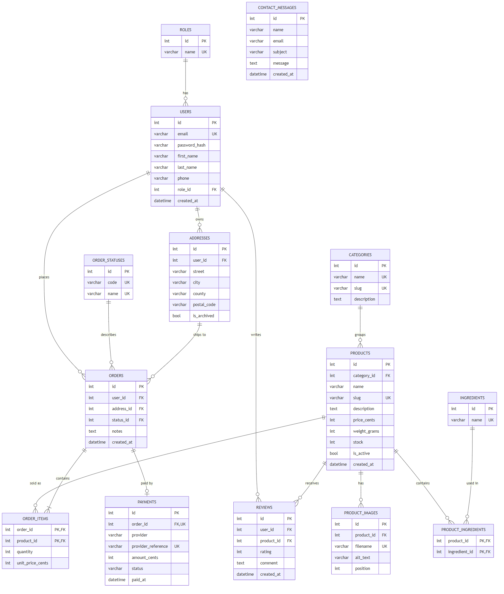

# Database

SQLite, managed with SQLAlchemy 2 models (`backend/app/models/`) and Alembic migrations (`backend/migrations/`). 14 tables, all in third normal form (rubric 2.01).

Source: [`database.mmd`](database.mmd) (Mermaid) · Vector: [`database.svg`](database.svg)

## Tables

| Table | Purpose |
|---|---|
| `roles` | `client`, `admin` |
| `users` | Accounts; password stored as scrypt hash |
| `addresses` | Delivery addresses; archived instead of edited once used by an order |
| `categories` | Jams, Preserves, Fruit Butters, Seasonal Editions |
| `products` | Jars on sale; price in cents (integer), stock, active flag |
| `product_images` | Ordered images per product, with alt text |
| `ingredients` | Shared ingredient list |
| `product_ingredients` | Many-to-many between products and ingredients |
| `order_statuses` | Stable `code` used by the code + display `name` shown on the site |
| `orders` | Who ordered, where it ships, current status |
| `order_items` | Products in an order, with the price at purchase time |
| `payments` | Stripe payment for an order (one per order) |
| `reviews` | 1–5 star review, one per user and product |
| `contact_messages` | Messages from the contact form |

## Why it is in 3NF

- **1NF:** every column holds a single atomic value; lists (ingredients, images, order lines) live in their own tables.
- **2NF:** the two composite keys (`order_items`, `product_ingredients`) have no partial dependencies: `quantity` and `unit_price_cents` depend on the whole (order, product) pair.
- **3NF:** no non-key column depends on another non-key column. Repeated labels (roles, statuses, categories, ingredients) are lookup tables referenced by foreign key.
- **No derived data stored:** order total and average rating are computed (`Order.total_cents`, `Product.average_rating`).
- `order_items.unit_price_cents` is not a copy of `products.price_cents`: it is the historical price at the moment of purchase, a fact of the order line.
- `payments.amount_cents` is the amount actually captured by Stripe, recorded for audit.

## Integrity rules enforced by the database

- Foreign keys on (SQLite `PRAGMA foreign_keys=ON` on every connection); categories, statuses, products used in orders cannot be deleted (`RESTRICT`).
- Unique: user email, category name/slug, product slug, image filename, ingredient name, status code/name, payment reference, one payment per order, one review per user and product.
- Checks: price, weight, quantity, amount > 0; stock ≥ 0; rating between 1 and 5.

All of the above is covered by tests in `backend/tests/test_models.py`.
